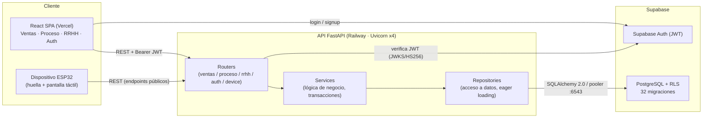

# ERP Colválvulas — Sistema de gestión empresarial full-stack

> Documento de perfil profesional para hoja de vida / portafolio.
> Proyecto desarrollado y mantenido de forma end-to-end (backend, frontend, base de datos, despliegue e IoT).

---

## Resumen ejecutivo

Diseño, desarrollo y operación de un **ERP a medida en producción** para una empresa del sector
industrial (válvulas), que digitaliza sus procesos de **ventas, inventario, remisiones, planeación
de producción y recursos humanos**. El sistema integra una API REST en **FastAPI**, un frontend
**React + TypeScript** modular, una base de datos **PostgreSQL (Supabase)** con control de acceso a
nivel de fila, y un **dispositivo IoT (ESP32)** con lector biométrico para el control de asistencia.

- **Rol:** Desarrollador full-stack — responsable único del ciclo completo (arquitectura, implementación, pruebas, despliegue y soporte en producción).
- **Duración:** Febrero 2026 – actualidad.
- **Escala del código:** ~5.800 líneas de Python (backend), ~11.800 líneas de TypeScript/TSX (frontend), 20 entidades de dominio, 32 migraciones SQL versionadas.
- **Arquitectura:** Clean Architecture por capas (Router → Service → Repository) en el backend; arquitectura modular por dominio (feature-based) en el frontend.

---

## Stack tecnológico

### Backend — API REST
| Categoría | Tecnología |
|---|---|
| Lenguaje | Python 3 |
| Framework | FastAPI (documentación OpenAPI/Swagger automática) |
| Servidor ASGI | Uvicorn (4 workers en producción) |
| ORM | SQLAlchemy 2.0 (estilo declarativo moderno) |
| Validación / serialización | Pydantic v2 + pydantic-settings |
| Autenticación | JWT (Supabase Auth) — verificación vía JWKS con *fallback* HS256 (`python-jose`, `PyJWT`) |
| Cliente HTTP | httpx (integración con la API de administración de Supabase) |
| Driver BD | psycopg2 |

### Frontend — SPA
| Categoría | Tecnología |
|---|---|
| Lenguaje | TypeScript 5.6 |
| Librería UI | React 18 |
| Build tool | Vite 5 |
| Enrutamiento | React Router 6 (rutas protegidas por rol, *code splitting* por app) |
| Estado de servidor | TanStack React Query 5 (caché, invalidación, *refetch* controlado) |
| Estado global de cliente | Zustand 5 |
| Cliente HTTP | Axios (interceptores de auth y manejo de errores) |
| Estilos | TailwindCSS 3 + PostCSS + Autoprefixer |
| Exportación de datos | SheetJS (`xlsx`) para reportes en Excel |
| Calidad | ESLint 9 + typescript-eslint, `tsc` en modo *build* |

### Base de datos
| Categoría | Tecnología |
|---|---|
| Motor | PostgreSQL (gestionado en Supabase) |
| Seguridad | Row Level Security (RLS) en todas las tablas |
| Migraciones | 32 *scripts* SQL versionados y aplicados en orden (incluye índices sobre FKs, constraints de inventario no negativo, triggers de sincronización de usuarios) |
| Conexiones | *Connection pooler* de Supabase (PgBouncer, modo *transaction*, puerto 6543) + pool propio por worker afinado en SQLAlchemy |

### IoT — Control de asistencia biométrico
| Categoría | Tecnología |
|---|---|
| Hardware | ESP32, sensor de huella AS608, pantalla TFT táctil ILI9341 240×320 (touch XPT2046) |
| Firmware | C++ (Arduino IDE) — máquina de estados de pantallas, enrolamiento con PIN, reconexión WiFi con reintentos |
| Librerías | Adafruit Fingerprint, TFT_eSPI, XPT2046_Touchscreen, ArduinoJson 7 |
| Integración | Consume *endpoints* públicos dedicados del backend (`/device/event`, `/device/employees`) |

### Infraestructura y DevOps
| Categoría | Tecnología |
|---|---|
| Backend en producción | Railway (build con Nixpacks, `startCommand` con Uvicorn multi-worker, *restart policy* ante fallos) |
| Frontend en producción | Vercel (SPA con *rewrites*, variables `VITE_` por entorno) |
| BaaS | Supabase (PostgreSQL + Auth + gestión de claves `anon` / `service_role`) |
| Configuración | Variables de entorno separadas por capa, `.env.example` documentado, CORS restringido por origen en producción |
| Control de versiones | Git (flujo con rama `dev` y `main`) |
| Pruebas | Pytest — 72 pruebas automatizadas (reglas de negocio, permisos por rol, CRUD, reportes, planeación, asistencia) con *fixtures* en `conftest.py` |

---

## Arquitectura de la solución

### Decisiones de arquitectura destacadas
- **Separación estricta en tres capas** (Router → Service → Repository) con un `BaseRepository` genérico reutilizable; la lógica de negocio y las transacciones viven en los *services*, no en los *controllers*.
- **API versionada y segmentada por dominio** (`/api/v1/ventas`, `/api/v1/proceso`, `/api/v1/rrhh`, `/api/v1/auth`) montada dinámicamente, con doble prefijo para retrocompatibilidad de clientes.
- **RBAC** implementado como *dependencies* de FastAPI (`require_admin`, `require_roles(...)`) sobre roles del dominio: `admin`, `almacenero`, `auditor_contable`, `vendedor`, entre otros; complementado con **RLS** en la base de datos como segunda línea de defensa.
- **Manejo de errores centralizado** con una jerarquía `AppException` propia y *exception handlers* globales que devuelven respuestas JSON consistentes sin exponer *stack traces*.
- **Frontend modular por feature**: cada módulo (`pedidos`, `inventario`, `remisiones`, `reportes`, `asistencia`, `planeacion`, …) encapsula sus `pages/`, `hooks/`, `services/` y `types/`; código transversal aislado en `shared/`.
- **Gestión de estado por responsabilidad**: React Query para el estado del servidor (caché e invalidación), Zustand para estado de sesión/UI — sin *prop drilling* ni *stores* monolíticos.

---

## Módulos funcionales entregados

| Dominio | Funcionalidad |
|---|---|
| **Ventas** | Clientes (con campos tributarios/NIT), catálogo de productos, **listas de precio por vendedor**, pedidos con detalle y cálculo automático de subtotales/totales, flujo de estados del pedido, "marcar enviado" que **genera remisión y salidas de inventario de forma atómica**, número de guía. |
| **Inventario** | Stock por producto, movimientos (entrada / salida / ajuste) con *constraint* de no-negatividad en BD, reporte de movimientos con filtros. |
| **Remisiones** | Generación automática desde pedido, detalle, consulta y reversión controlada. |
| **Inventario de proceso** | Movimientos de planta con registro de stock antes/después y trazabilidad de quién registra. |
| **Planeación** | Dependencias, asignación de tareas a empleados, seguimiento de cantidad realizada, vista "mis tareas". |
| **Recursos Humanos** | Maestro de empleados, **control de asistencia biométrico** vía ESP32, reporte con detección de entradas tardías, gestión de acceso empleado↔usuario. |
| **Reportes** | Reportes de ventas e inventario con filtros y **exportación a Excel**. |
| **Administración** | Gestión de usuarios, roles y asignaciones; sincronización automática usuario↔auth mediante *trigger* en la BD. |

---

## Logros técnicos destacados (con métricas)

- **Optimización de rendimiento bajo concurrencia:** diagnostiqué y documenté un informe con **18 hallazgos** de rendimiento en el backend (patrones N+1, sesiones mal gestionadas, *round-trips* redundantes). La corrección más significativa redujo la carga de la pantalla *Control de Pedidos* de **~500 consultas SQL a 1** aplicando `joinedload`/`selectinload`.
- **Estrategia de conexiones para multiusuario:** migré de `NullPool` a un pool pequeño y persistente por worker (evitando el coste de TCP+TLS+auth por request) detrás del *pooler* de Supabase, y dejé calculado y documentado el techo real de conexiones (`workers × (pool_size + max_overflow)`) frente al límite del plan.
- **Transaccionalidad del negocio:** aseguré operaciones compuestas (envío de pedido → remisión → movimientos de stock → actualización) para que sean **atómicas**, evitando estados inconsistentes ante fallos parciales.
- **Integración hardware–software:** llevé un lector de huellas y pantalla táctil desde el firmware (calibración de *touch*, *pull-down* en pin de *strapping*, reconexión WiFi) hasta el reporte de asistencia en la SPA, definiendo el contrato de *endpoints* públicos del dispositivo.
- **Base de datos evolutiva y segura:** 32 migraciones versionadas sin *downtime* percibido, RLS en todas las tablas, *constraints* de integridad (inventario no negativo), índices sobre claves foráneas y limpieza posterior de índices no usados.
- **Suite de pruebas de regresión:** 72 pruebas con Pytest cubriendo reglas de negocio críticas y la **matriz de permisos por rol**.

---

## Buenas prácticas aplicadas

- Arquitectura limpia y por capas; principio de responsabilidad única en *services* y *repositories*.
- Tipado estricto de extremo a extremo: Pydantic v2 en el backend, TypeScript estricto en el frontend, contratos de API y *types* del cliente actualizados en conjunto.
- Configuración por entorno vía variables de entorno; secretos fuera del repositorio; separación de claves `anon` (cliente) y `service_role` (servidor).
- CORS restringido por origen en producción; verificación de JWT con rotación de claves (JWKS).
- Documentación técnica viva del proyecto: informes de rendimiento, guía de concurrencia, guía de migración y README por capa.
- Pruebas automatizadas como red de seguridad antes de desplegar; despliegue continuo desde Git a Railway y Vercel.

---

## Versión corta para la hoja de vida

**Desarrollador Full-Stack — ERP Colválvulas** · *Feb 2026 – actualidad*

- Diseñé y desarrollé un ERP en producción (ventas, inventario, remisiones, planeación de producción y RRHH) como responsable único del backend, frontend, base de datos e infraestructura.
- Backend en **FastAPI + SQLAlchemy 2.0 + PostgreSQL (Supabase)** con Clean Architecture (Router→Service→Repository), API REST versionada, **RBAC** por *dependencies* y **RLS** en base de datos.
- Frontend **React 18 + TypeScript + Vite** con arquitectura modular por dominio, **TanStack React Query** para estado de servidor y **Zustand** para estado de cliente; reportes exportables a Excel.
- Reduje una pantalla crítica de **~500 consultas SQL a 1** (corrección de N+1) y rediseñé la estrategia de *connection pooling* para soportar múltiples usuarios concurrentes.
- Integré un **dispositivo IoT ESP32** con lector biométrico de huella para control de asistencia, desde el firmware en C++ hasta el reporte en la aplicación web.
- **32 migraciones SQL** versionadas y **72 pruebas automatizadas** (Pytest) sobre reglas de negocio y permisos.
- Despliegue en **Railway** (API, Uvicorn multi-worker) y **Vercel** (SPA), con configuración por entorno y CI desde Git.

---

## Descripción de una línea (LinkedIn / portafolio)

> ERP full-stack en producción para el sector industrial: FastAPI + PostgreSQL/Supabase (Clean Architecture, RBAC, RLS), React + TypeScript (arquitectura modular, React Query, Zustand) e integración IoT con ESP32 biométrico. Desplegado en Railway y Vercel.

---

## Palabras clave (ATS)

`Python` · `FastAPI` · `SQLAlchemy 2.0` · `Pydantic v2` · `PostgreSQL` · `Supabase` · `REST API` ·
`JWT` · `RBAC` · `Row Level Security` · `Clean Architecture` · `Repository Pattern` ·
`React 18` · `TypeScript` · `Vite` · `TanStack React Query` · `Zustand` · `React Router` ·
`TailwindCSS` · `Axios` · `Pytest` · `Railway` · `Vercel` · `CI/CD` · `Git` ·
`Optimización de rendimiento` · `N+1` · `Connection Pooling` · `IoT` · `ESP32` · `Arduino/C++` ·
`ERP` · `Full-Stack Developer`
